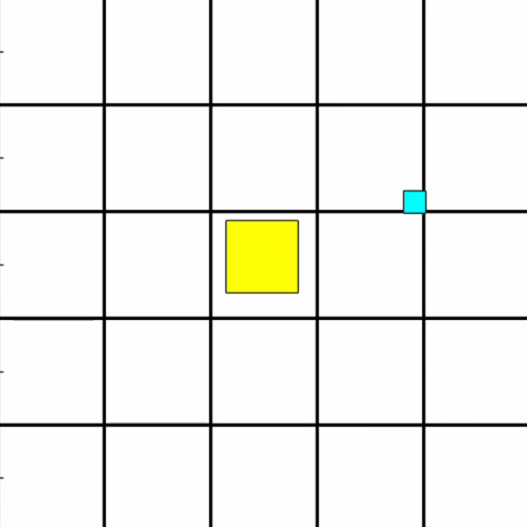

# Reinforcement Learning for Parcel Singulation in MATLAB

A MATLAB reinforcement learning project for controlling a 5 × 5 array of modular surfaces (AMS) to separate parcels as they travel toward an exit. A Proximal Policy Optimization (PPO) agent selects the rotation and speed of each cell in a custom simulation environment.



## What the project contains

- `RL_environment.m` — parcel motion, collisions, observations, actions, and reward calculation. The environment has 75 observation values (parcel x position, y position, and size for each cell) and 50 continuous actions (rotation and speed for each of the 25 cells).
- `RL_main.m` — PPO actor and critic setup, training configuration, and simulation. It replays the included trained agent by default; set `dotrain = true` to retrain.
- `AMSVisualizer_simple.m` — animation of the sorting surface.
- `agent_trained_final.mat` and `trainingStats_final.mat` — saved agent and training statistics.
- `plot_training.m` — plot the saved episode rewards and estimated Q values.
- `save_video_new.m` — record a short simulation with the saved agent.
- `results/` — selected images from the project. These are illustrative outputs from the original work; the repository does not assert benchmark metrics from them.

## Requirements

- MATLAB (developed with R2025b)
- Reinforcement Learning Toolbox
- Deep Learning Toolbox

## Run

Open MATLAB in this folder, then run:

```matlab
RL_main
```

This loads `agent_trained_final.mat` and runs one simulation of up to 1,000 steps. To train an agent from scratch, set `dotrain = true` near the top of `RL_main.m`. Training is configured for up to 3,000 episodes and can take considerable time. The script saves the resulting agent and statistics to the same filenames.

To inspect the saved training statistics or record a demonstration, run `plot_training` or `save_video_new` respectively. The video script writes `trained_agent_video_simple.mp4` into the working folder.

## Scope

This repository is a compact presentation of the main implementation and one saved run. It omits alternate environments, intermediate checkpoints, backups, and duplicate analysis scripts from the working directory. The original project also contains exploratory evaluation scripts using different agent files; their output charts are shown here for context, but those scripts are not part of the runnable core.

This was developed as a Politecnico di Milano machine learning course project.
